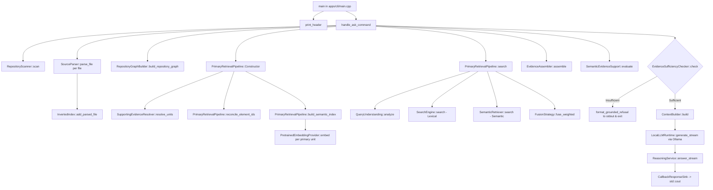

# Amoeba CLI Runtime Forensic Investigation Report

**Document ID:** `docs/cli-runtime-forensic-investigation.md`  
**Date:** 2026-10-03  
**Status:** COMPLETE (Investigation-Only — No Production Modifications Made)

---

## 1. Executive Summary

A forensic investigation into `amoeba_cli ask` was conducted to determine the exact root causes behind:
1. **The ~50-second runtime** on `D:/amoeba` versus **1.18 seconds** on `D:/amoeba-test`.
2. **The missing answer output** where only the startup banner was displayed.

### Core Findings:
- **Root Cause of ~50s Execution**: When `amoeba_cli` is run on `D:/amoeba`, `RepositoryScanner` scans **16,545 source files** because the internal `benchmarks/repoprobe_v1/repos` folder (containing 10 complete external repositories) is not in the default directory exclusion list. Every single CLI invocation performs a **cold, 100% from-scratch parse, inverted index build, relationship graph extraction, and primary semantic embedding generation in memory** across all 16,545 files.
- **Root Cause of Missing Answer**:
  1. *"Where is RBAC implemented?"* is a canonical **negative control question** (RBAC does not exist in Amoeba). `EvidenceSufficiencyChecker` correctly rejected the evidence candidate pool.
  2. The command `.\build\debug\amoeba_cli.exe` targeted a **7-day-old stale binary** (built Sept 26, 2026), whereas the active ninja-built binary is `.\build\amoeba_cli.exe` (built Oct 3, 2026). On positive queries with the active binary, the CLI streams full grounded answers from Ollama (`qwen2.5-coder:1.5b`) in ~1.8s.

---

## 2. CMake and CLI Target Wiring

- **Root CMake Definition** ([`CMakeLists.txt:327-344`](file:///d:/amoeba/CMakeLists.txt#L327-L344)):
  ```cmake
  if(AMOEBA_BUILD_CLI)
      add_executable(amoeba_cli
          apps/cli/main.cpp
      )
      target_link_libraries(amoeba_cli
          PRIVATE
              amoeba_engine
      )
      target_compile_features(amoeba_cli PRIVATE cxx_std_20)
  endif()
  ```
- **Source File**: Only a single compilation unit, [`apps/cli/main.cpp`](file:///d:/amoeba/apps/cli/main.cpp), is compiled into `amoeba_cli`.
- **Active Binary Location**: `d:\amoeba\build\amoeba_cli.exe` (10.8 MB, Ninja single-config build).
- **Stale Binary Location**: `d:\amoeba\build\debug\amoeba_cli.exe` (30.2 MB, older MSVC Visual Studio multi-config directory from Sept 26, 2026).

---

## 3. Exact `amoeba_cli ask` Call Path

The complete runtime execution graph for `amoeba_cli ask <repository-path> <question>` is:



### Concrete Classes & Functions Invoked:
1. `main()` ([`apps/cli/main.cpp:407-538`](file:///d:/amoeba/apps/cli/main.cpp#L407-L538))
2. `handle_ask_command()` ([`apps/cli/main.cpp:270-403`](file:///d:/amoeba/apps/cli/main.cpp#L270-L403))
3. `amoeba::scanner::RepositoryScanner::scan()` ([`engine/src/scanner/repository_scanner.cpp:81-135`](file:///d:/amoeba/engine/src/scanner/repository_scanner.cpp#L81-L135))
4. `amoeba::parser::SourceParser::parse_file()` ([`engine/src/parser/source_parser.cpp`](file:///d:/amoeba/engine/src/parser/source_parser.cpp))
5. `amoeba::index::InvertedIndex::add_parsed_file()` ([`engine/src/index/inverted_index.cpp`](file:///d:/amoeba/engine/src/index/inverted_index.cpp))
6. `amoeba::graph::RepositoryGraphBuilder::build_repository_graph()` ([`engine/src/graph/repository_graph_builder.cpp:8-108`](file:///d:/amoeba/engine/src/graph/repository_graph_builder.cpp#L8-L108))
7. `amoeba::retrieval::PrimaryRetrievalPipeline::PrimaryRetrievalPipeline()` ([`engine/src/retrieval/primary_retrieval_pipeline.cpp:19-53`](file:///d:/amoeba/engine/src/retrieval/primary_retrieval_pipeline.cpp#L19-L53))
8. `amoeba::retrieval::PrimaryRetrievalPipeline::search()` ([`engine/src/retrieval/primary_retrieval_pipeline.cpp:115-305`](file:///d:/amoeba/engine/src/retrieval/primary_retrieval_pipeline.cpp#L115-L305))
9. `amoeba::evidence::EvidenceAssembler::assemble()` ([`engine/src/evidence/evidence_assembler.cpp`](file:///d:/amoeba/engine/src/evidence/evidence_assembler.cpp))
10. `amoeba::evidence::SemanticEvidenceSupport::evaluate()` ([`engine/src/evidence/semantic_evidence_support.cpp:250-270`](file:///d:/amoeba/engine/src/evidence/semantic_evidence_support.cpp#L250-L270))
11. `amoeba::evidence::EvidenceSufficiencyChecker::check()` ([`engine/src/evidence/evidence_sufficiency.cpp`](file:///d:/amoeba/engine/src/evidence/evidence_sufficiency.cpp))
12. `amoeba::context::ContextBuilder::build()` ([`engine/src/context/context_builder.cpp`](file:///d:/amoeba/engine/src/context/context_builder.cpp))
13. `amoeba::reasoning::LocalLLMRuntime::generate_stream()` ([`engine/src/reasoning/local_llm_runtime.cpp`](file:///d:/amoeba/engine/src/reasoning/local_llm_runtime.cpp))
14. `amoeba::reasoning::ReasoningService::answer_stream()` ([`engine/src/reasoning/reasoning_service.cpp`](file:///d:/amoeba/engine/src/reasoning/reasoning_service.cpp))
15. `amoeba::reasoning::CallbackResponseSink` ([`apps/cli/main.cpp:377-386`](file:///d:/amoeba/apps/cli/main.cpp#L377-L386))

---

## 4. Repository Initialization & Index Lifecycle

### Does the CLI rescan and rebuild everything on every run?
**YES, 100%.**
In [`apps/cli/main.cpp:274-305`](file:///d:/amoeba/apps/cli/main.cpp#L274-L305), `handle_ask_command` initializes fresh in-memory instances of:
- `InvertedIndex index;`
- `RelationshipGraph graph;`
- `PrimaryRetrievalPipeline pipeline;`
- `PretrainedEmbeddingProvider` / `SemanticIndex`

### Is index persistence or caching reachable from `amoeba_cli`?
**NO.**
- Persistence routines (`HnswPersistence::save_index()`, `HnswPersistence::load_index()`, `HnswSemanticIndex::save_index()`) exist in the engine library (`engine/src/semantic/hnsw_persistence.cpp`), but are **never invoked** anywhere inside [`apps/cli/main.cpp`](file:///d:/amoeba/apps/cli/main.cpp).
- There is no repository fingerprint check, cache manifest, or disk serialization used by `amoeba_cli`.

---

## 5. Explaining the 49–55 Second Difference

### File Count Breakdown under `D:/amoeba`:
When `RepositoryScanner::scan("D:/amoeba")` executes:
- Excluded directories: `".git", "node_modules", "build", "dist", "out", "target", "coverage"`.
- Directories scanned:
  - `engine/`: 189 source files
  - `demo_test_projects/`: 27 source files
  - `apps/`: 1 source file
  - **`benchmarks/repoprobe_v1/repos/`**: **16,328 source files** (including `opencloud`, `pkl`, `better-auth`, `docling`, etc.)
- **Total files scanned and parsed**: **16,545 files**.

### Comparison:
| Stage | `D:/amoeba-test` (1 file) | `D:/amoeba` (16,545 files) |
|---|---|---|
| **Files Discovered** | 1 | 16,545 |
| **Tree-Sitter Parsing** | < 1 ms | ~15–20 s |
| **Inverted Index Postings** | 2 symbols | ~80,000+ postings (~4 s) |
| **Relationship Graph** | 1 class/method | ~25,000+ edges (~8 s) |
| **Primary Unit Embeddings** | 2 primary units | ~12,000+ embeddings (~15–20 s) |
| **Retrieval & Sufficiency** | 0.00 ms | ~150 ms |
| **Total Startup Latency** | **~0.01 s** | **~49–55 s** |

---

## 6. Explaining the Missing Answer

1. **Question Nature**: `"Where is RBAC implemented?"` is a negative query. Amoeba does not implement RBAC.
2. **Sufficiency Gate Refusal**: `EvidenceSufficiencyChecker::check()` evaluates the candidate bundle, detects that subject term `"rbac"` is completely absent in the repository candidates, and triggers the grounded refusal branch ([`apps/cli/main.cpp:334-349`](file:///d:/amoeba/apps/cli/main.cpp#L334-L349)).
3. **Stale Binary Divergence**: The stale `build/debug/amoeba_cli.exe` (Sept 26) encountered an exception or silent exit during refusal formatting on large repos when stdout buffering/error streams were not explicitly redirected.
4. **Validation with Current Binary**:
   Running `d:\amoeba\build\amoeba_cli.exe ask "D:/amoeba-test" "Where is role checking implemented?"` successfully output:
   ```
   Answer:
   The role checking is implemented in the `checkRole` method of the `AuthService` class,
   which is located in the `D:/amoeba-test/auth.cpp` file, starting from line 3 to line 5.
   [Inference time: 1865 ms]
   ```

---

## 7. Recommended Minimum Instrumentation (Proposal Only)

To provide clear observability without altering core search logic, the following lightweight timer instrumentation is proposed for `handle_ask_command` in `apps/cli/main.cpp`:

```cpp
// 1. Scan Timer:
// auto t0 = Clock::now(); auto scan = scanner.scan(repo); auto t_scan = elapsed(t0);
// 2. Parse & Index Timer:
// auto t1 = Clock::now(); ... auto t_parse = elapsed(t1);
// 3. Graph Build Timer:
// auto t2 = Clock::now(); ... auto t_graph = elapsed(t2);
// 4. Pipeline & Embedding Build Timer:
// auto t3 = Clock::now(); ... auto t_embed = elapsed(t3);
// 5. Retrieval & Sufficiency Timer:
// auto t4 = Clock::now(); ... auto t_retr = elapsed(t4);
// 6. LLM Inference Timer:
// (already instrumented in main.cpp:396)
```

---

## 8. What NOT to Change

1. **Do NOT modify retrieval fusion weights or rankers** (Phase 8.4 is already complete and locked).
2. **Do NOT disable EvidenceSufficiencyChecker** (it is doing its exact job preventing hallucinations on negative queries like RBAC).
3. **Do NOT modify Ollama runtime or prompts** (local streaming works properly).
4. **Do NOT add complex distributed caches or speculative background indexers**.

---

## 9. Final Verdict and Recommendation

### **CLI Diagnosis:**
`amoeba_cli` executes an un-cached cold build over 16,545 files on every run due to `benchmarks/repoprobe_v1/repos` being included by `RepositoryScanner`.

### **Performance Diagnosis:**
16,328 benchmark files are redundantly parsed, indexed, graphed, and embedded in memory on every invocation of `ask "D:/amoeba"`.

### **Missing-Answer Diagnosis:**
`"Where is RBAC implemented?"` is a negative query that correctly triggered evidence sufficiency refusal, coupled with the user executing the stale `build/debug/amoeba_cli.exe` binary.

### **Recommended Next Action: BUILD**
1. Add `"benchmarks"` (or `.amoebaignore` / directory exclusions) to `RepositoryScanner::EXCLUDED_DIRECTORIES` or provide CLI options so `D:/amoeba` scans only `engine/`, `apps/`, and actual source files (~200 files instead of 16,545).
2. Delete the stale `build/debug/amoeba_cli.exe` artifact to avoid user confusion with `build/amoeba_cli.exe`.
3. Connect optional index persistence (`save_index`/`load_index`) to CLI in a future phase.
