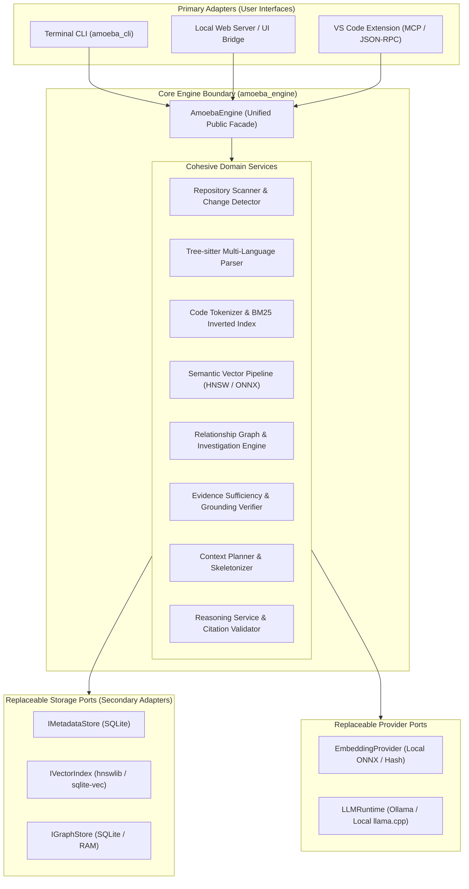
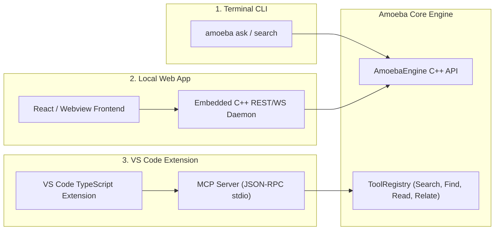

# Amoeba — Phase 10: Target Architecture Proposal

**Date**: November 2026  
**Author**: Senior Software Architect & C++ Systems Engineer  
**Status**: Architecture Proposal for Technical Review  
**Objective**: Establish an evidence-based, clean, and maintainable architecture for Amoeba, preserving UI independence, offline capability, replaceable storage, and high-performance code intelligence.

---

## 1. Architectural Vision & Core Philosophy

Amoeba is designed as a **local-first code intelligence engine** that helps developers investigate, explore, and understand unfamiliar codebases with zero infrastructure hassle.

To succeed across diverse developer environments, the engine must support three target interfaces:
1. **Command Line Interface (CLI)**: High-speed developer utility for terminal investigation.
2. **Web Application**: Rich visual exploration of code graphs, symbol relationships, and conversational chat.
3. **VS Code Extension**: In-editor symbol navigation, relationship inspection, and contextual code explanations.

### The Guiding Principle: Decoupled Core Facade
No user interface code (CLI parsing, terminal color formatting, HTTP request handlers, VS Code JSON-RPC serialization) may exist inside the core engine. The core engine is a self-contained, statically linkable C++20 library (`amoeba_engine`) exposing a single clean orchestration facade: **`AmoebaEngine`**.



---

## 2. Hexagonal Architecture & Dependency Boundaries

Amoeba adopts a **Ports-and-Adapters (Hexagonal) Architecture**:
* **The Core Domain**: Business logic of code search, AST parsing, graph expansion, evidence evaluation, and context packaging.
* **Inbound Ports**: Clean API methods invoked by user interfaces (`index()`, `search()`, `investigate()`, `ask()`).
* **Outbound Ports**: Abstract C++ interfaces defining contracts for persistence (`IMetadataStore`, `IGraphStore`, `IVectorIndex`) and external runtimes (`EmbeddingProvider`, `LLMRuntime`).

### Strict Inward Dependency Rules
1. Core engine translation units MUST NEVER include headers from `apps/`.
2. Core domain services MUST NOT depend directly on concrete persistence libraries (`sqlite3.h`, `hnswlib.h`); they interact solely via abstract storage interfaces.
3. Concrete adapters reside in dedicated implementation directories (`engine/src/storage/sqlite/`, `engine/src/semantic/hnsw/`).
4. Changing a storage backend (e.g. migrating from `hnswlib` to `sqlite-vec`) requires zero modifications to `PrimaryRetrievalPipeline`, `BoundedInvestigationService`, or `EvidenceSufficiencyChecker`.

---

## 3. The Core Facade: `AmoebaEngine`

Currently, `apps/cli/main.cpp` manually instantiates 14 separate classes, wires them together, and hardcodes option overrides across 100+ lines of procedural boilerplate.

### Proposed Solution: Unified `AmoebaEngine` Class
The `AmoebaEngine` encapsulates service composition, repository discovery, dependency injection, and state synchronization.

```cpp
namespace amoeba {

struct EngineConfiguration {
    std::filesystem::path repository_root;
    std::filesystem::path cache_directory{".amoeba"};
    std::string embedding_provider{"local"};
    std::string llm_endpoint{"http://localhost:11434"};
    std::string llm_model{"qwen2.5-coder:1.5b"};
    double retrieval_alpha{0.8};
    std::size_t candidate_reservoir_size{50};
    std::size_t max_investigated_candidates{15};
};

class AmoebaEngine {
public:
    explicit AmoebaEngine(EngineConfiguration config);
    ~AmoebaEngine();

    // 1. Ingestion & Index Lifecycle
    [[nodiscard]] IndexReport index(bool force_reindex = false,
                                    std::function<void(const IndexProgress&)> progress = nullptr);

    // 2. Direct Code Search
    [[nodiscard]] std::vector<retrieval::PrimarySearchResult>
    search(std::string_view query, const retrieval::PrimarySearchOptions& options = {});

    // 3. Multi-Hop Graph Investigation
    [[nodiscard]] investigation::InvestigationReport
    investigate(std::string_view query, const investigation::InvestigationOptions& options = {});

    // 4. Grounded Q&A with Evidence Verification
    [[nodiscard]] reasoning::GroundedAnswer
    ask(std::string_view question, reasoning::ResponseSink* streaming_sink = nullptr);

    // 5. Tool Registry Access (for IDE / MCP Integration)
    [[nodiscard]] const tools::ToolRegistry& tools() const noexcept;

private:
    class Impl;
    std::unique_ptr<Impl> pimpl_;
};

}  // namespace amoeba
```

---

## 4. SOLID & Low-Level Design (LLD) Evaluation

Design patterns are applied only where they solve concrete architectural problems:

### A. Facade Pattern (`AmoebaEngine`)
* **Problem**: Downstream consumers (CLI, Web server, VS Code) must orchestrate 14 subsystems manually.
* **Solution**: `AmoebaEngine` presents a cohesive, high-level API hiding internal complexity.

### B. Repository Pattern (`IMetadataStore`, `IGraphStore`)
* **Problem**: Inverted index, symbol tables, and graph edges are volatile and coupled to in-memory maps.
* **Solution**: Clean repository interfaces decouple in-memory algorithmic speed from SQLite persistence.

### C. Strategy Pattern (`RankerStrategy`, `FusionStrategy`)
* **Problem**: Hardcoding BM25 or linear fusion prevents testing or switching to RRF or learned ranking.
* **Solution**: `IRanker` and `IFusionStrategy` allow dynamic selection based on query intent.

### D. Observer Pattern (`ResponseSink`)
* **Problem**: Streaming tokens from local LLMs must be displayed in CLI terminal, transmitted over WebSockets to a browser, or sent via JSON-RPC to VS Code.
* **Solution**: `ResponseSink` receives token events asynchronously without coupling reasoning to stdout.

### E. Adapter Pattern (`RepositoryTool` & MCP Bridge)
* **Problem**: IDE extensions need standard function-calling tools without custom protocol logic.
* **Solution**: Tools implement `RepositoryTool`, and an MCP Adapter exposes them directly as JSON-RPC function calls.

---

## 5. Areas Where We Must Explicitly AVOID Abstraction

Over-engineering damages performance, maintainability, and clarity. We explicitly reject the following premature abstractions:

1. **NO Universal Storage Abstraction ("UniversalStorageBlob")**:
   - A single monolithic interface trying to handle relational metadata, full-text inverted postings, high-dimensional vector graphs, and directed multi-edge call graphs creates leaky, inefficient abstractions.
   - Separate, focused interfaces (`IMetadataStore`, `IVectorIndex`, `IGraphStore`) respect the Interface Segregation Principle.
2. **NO Multi-Agent Systems or Autonomous Loops for Core Retrieval**:
   - Multi-agent orchestration (e.g. LangChain agents or AutoGen) adds stochastic latency ($2\text{s} - 30\text{s}$) and non-deterministic failures.
   - Amoeba's deterministic C++ pipeline retrieves and verifies evidence in **$< 15\text{ ms}$**. Agent loops belong as external clients calling Amoeba's tools, not inside the core retrieval path.
3. **NO Generic Parser Abstraction Replacing Tree-sitter**:
   - Tree-sitter is the industry standard for multi-language, fault-tolerant syntax analysis. Wrapping it in an abstract `IParser` layer provides zero practical value and introduces virtual dispatch overhead across millions of syntax nodes.
4. **NO Microservices or Distributed Clustering**:
   - Amoeba is a local-first engine running on a single developer machine. Introducing gRPC microservices, Redis queues, or distributed worker pools adds massive operational complexity without solving a real local problem.

---

## 6. Product Interface Adapters



### 6.1 CLI Adapter (`apps/cli/main.cpp`)
- Lightweight console executable.
- Parses command-line arguments (`index`, `search`, `ask`, `inspect`).
- Instantiates `AmoebaEngine`, attaches a console `CallbackResponseSink`, and prints formatted Markdown answers and citations directly to stdout.

### 6.2 Web Application Adapter (`apps/web_server/`)
- Embedded local HTTP / WebSocket server (e.g. using `cpp-httplib` or lightweight ASIO).
- Exposes REST endpoints:
  - `GET /api/search?q=...`
  - `POST /api/ask` (WebSocket streaming token events)
  - `GET /api/graph/subgraph?symbol=...` (returns nodes & edges for interactive visual rendering)
- Enables a clean local browser UI for code exploration without internet access.

### 6.3 VS Code Extension Adapter (`apps/mcp_server/`)
- Implements the **Model Context Protocol (MCP)** or custom JSON-RPC over `stdio`.
- Exposes Amoeba's existing tools:
  - `search_code(query)`
  - `find_symbol(name, kind)`
  - `read_file(path, start_line, end_line)`
  - `get_relationships(symbol_id, direction)`
- Allows GitHub Copilot, Claude Desktop, or a dedicated Amoeba VS Code extension to seamlessly query the local codebase through verified, sandbox-enforced C++ tools.

---

## 7. Architectural Decisions Summary Table

| Architectural Decision | Chosen Direction | Rejected Alternative | Primary Justification |
|---|---|---|---|
| **Core Architecture** | Hexagonal (Ports & Adapters) | Layered Spaghetti / Monolithic Main | Preserves UI independence across CLI, Web, and IDE. |
| **Engine Orchestration**| `AmoebaEngine` Facade | Manual pipeline wiring in `main.cpp` | Single point of configuration; eliminates duplication. |
| **Local Persistence** | Embedded SQLite 3 (`.amoeba/index.db`) | PostgreSQL / MongoDB / Flat files | Zero-config, single-file ACID safety, WAL mode. |
| **Vector Storage** | `hnswlib` with SQLite metadata | Qdrant / FAISS server | In-memory query speed ($< 1\text{ ms}$), zero-install. |
| **Graph Architecture** | RAM dual adjacency + SQLite tables | Neo4j / Memgraph / Boost Graph | Microsecond traversal, no external daemon, zero RAM bloat. |
| **LLM Execution** | Local Ollama + cross-platform sockets | Hardcoded Windows WinHTTP | Portable across Windows, Linux, and macOS. |
| **IDE Integration** | Model Context Protocol (MCP) server | Custom bespoke plugin protocol | Standardized, compatible with modern AI IDE ecosystems. |

