# Amoeba — Phase 10: Prioritised Architectural Roadmap

**Date**: November 2026  
**Auditor**: Senior Software Architect & Technical Reviewer  
**Status**: Roadmap for Technical Review & Phase Approval  
**Objective**: Establish a strict, evidence-based prioritization plan categorizing upcoming work into P0 (Correctness & Reliability), P1 (Core Architecture), P2 (Valuable Improvements), and P3 (Future Capabilities).

---

## 1. Roadmap Classification Framework

Items are prioritized based on user impact, correctness risk, and architectural necessity:
* **P0 — Correctness, Reliability, Data Integrity & Benchmark Validity**:  
  Must be addressed immediately. Critical bugs, parameter regressions, and data leaks that actively impair retrieval quality.
* **P1 — Core Architecture & Local-First Foundation**:  
  Core structural gaps that prevent Amoeba from being a fast, incremental, local-first engine.
* **P2 — Valuable Improvements & Semantic Hardening**:  
  Features that expand portability, semantic accuracy, and tool interoperability.
* **P3 — Future Capabilities & Extended Product Interfaces**:  
  Advanced visualizations, conversational multi-turn state, and broad multi-repository scaling.

---

## 2. Comprehensive Item Registry

```mermaid
flowchart TD
    subgraph P0 ["P0: Correctness & Integrity (Phase 11 Immediate)"]
        P0_1["Fix CLI Fusion Overrides<br>(alpha=0.8, adaptive=false)"]
        P0_2["Expand Scanner Exclusions<br>(.venv, vendor, .next, etc.)"]
        P0_3["Fix Interrogative Trap<br>(QueryUnderstanding intent precedence)"]
        P0_4["Purge Benchmark Repo Names<br>(Remove leakage from noise set)"]
        P0_5["Restore Candidate Reservoir<br>(k=50 search, 15 investigation)"]
    end

    subgraph P1 ["P1: Core Architecture (Phase 11 Foundation)"]
        P1_1["SQLite Metadata Store<br>(.amoeba/index.db persistence)"]
        P1_2["Incremental Change Detector<br>(mtime/hash skip unchanged files)"]
        P1_3["Context Anchor-Centered Windows<br>(Eliminate line-50 truncation)"]
        P1_4["Unified AmoebaEngine Facade<br>(Decouple engine from CLI)"]
        P1_5[".gitignore Parser<br>(Prune user-ignored folders)"]
        P1_6["Intent-Guided Graph Navigation<br>(Directional caller/callee traversal)"]
    end

    subgraph P2 ["P2: Valuable Improvements (Phase 12)"]
        P2_1["Cross-Platform LLM Sockets<br>(Linux/macOS loopback support)"]
        P2_2["True LLM Citation Validation<br>(Parse & verify output line ranges)"]
        P2_3["Local ONNX / Dense Embeddings<br>(Replace hash feature map)"]
        P2_4["Function Body Slicing<br>(Expose branch & return conditions)"]
        P2_5["MCP Server for VS Code<br>(JSON-RPC stdio tool bridge)"]
    end

    subgraph P3 ["P3: Future Capabilities (Phase 13+)"]
        P3_1["sqlite-vec Single-File Index"]
        P3_2["Multi-Turn Conversational Memory"]
        P3_3["Embedded Web Server & Graph UI"]
        P3_4["SCIP / LSIF Precision Indexing"]
    end

    P0 --> P1
    P1 --> P2
    P2 --> P3
```

---

## 3. Detailed Item Breakdown & Estimates

### 3.1 P0: Correctness, Reliability & Data Integrity (Phase 11 Mandatory)

#### Item P0.1: Fix CLI Retrieval Overrides & Inverted Fusion
* **Description**: Remove manual overrides in `apps/cli/main.cpp` where `.alpha = 0.5` and `.adaptive_fusion = true` actively degrade retrieval recall from 54.5% to 45.5%. Set engine default $\alpha = 0.8$ and `adaptive_fusion = false`.
* **Complexity**: **Low** (0.5 day).
* **Dependencies**: None.
* **Expected Impact**: Immediate +9.0% absolute recall boost on positive questions; exact identifiers are no longer suppressed.
* **Target Phase**: **Phase 11**.

#### Item P0.2: Expand Scanner Exclusions & CLI `--exclude` Flag
* **Description**: Expand `EXCLUDED_DIRECTORIES` in `repository_scanner.cpp` to include `.venv`, `venv`, `env`, `site-packages`, `vendor`, `.next`, `.nuxt`, `.turbo`, `.gradle`, `.idea`, `.vscode`, `__pycache__`. Add `--exclude="dir1,dir2"` argument to CLI.
* **Complexity**: **Low** (1 day).
* **Dependencies**: None.
* **Expected Impact**: Completely resolves perceived hangs on Python, Go, and Next.js repositories.
* **Target Phase**: **Phase 11**.

#### Item P0.3: Fix Interrogative Inversion Trap in Query Understanding
* **Description**: Invert logic in `QueryUnderstanding::analyze()` so that code syntax, camelCase transitions, and technical entities take priority over interrogative prefixes ("Where", "What", "?").
* **Complexity**: **Low** (0.5 day).
* **Dependencies**: None.
* **Expected Impact**: Symbol questions phrased conversationally are correctly routed to lexical-dominant search ($\alpha = 0.8$) instead of semantic collapse ($\alpha = 0.25$).
* **Target Phase**: **Phase 11**.

#### Item P0.4: Purge Benchmark Repository Names from Noise Filter
* **Description**: Remove `"pkl"`, `"dokploy"`, `"beszel"`, `"opencloud"`, `"ducklake"`, `"jiff"`, `"walker"`, `"docling"`, `"adk"`, `"better-auth"` from `kConversationalNoise`. Dynamically inject `root_path.filename().string()` at runtime.
* **Complexity**: **Low** (0.5 day).
* **Dependencies**: None.
* **Expected Impact**: Eliminates benchmark overfitting; restores scientific credibility and generalizability.
* **Target Phase**: **Phase 11**.

#### Item P0.5: Restore 50-Candidate Reservoir and 15-Item Investigation Pool
* **Description**: Set `search_opts.max_results = 50` and `invest_opts.max_total_candidates = 15` in CLI pipeline, matching Phase 9.3B findings.
* **Complexity**: **Low** (0.5 day).
* **Dependencies**: Item P0.1.
* **Expected Impact**: Rescues relevant symbols ranked 6–15 from premature elimination, eliminating false "Insufficient Evidence" refusals.
* **Target Phase**: **Phase 11**.

---

### 3.2 P1: Core Architecture & Local-First Foundation (Phase 11 Target)

#### Item P1.1: Embedded SQLite State Store (`.amoeba/index.db`)
* **Description**: Embed `sqlite3.c` into CMake; implement `SqliteMetadataStore` persisting file paths, mtimes, file hashes, and parsed code element records.
* **Complexity**: **Medium** (3–4 days).
* **Dependencies**: CMake build update.
* **Expected Impact**: Establishes durable, single-file local persistence; eliminates cold-start re-parsing.
* **Target Phase**: **Phase 11**.

#### Item P1.2: Incremental File Change Detection & Index Synchronization
* **Description**: On `amoeba ask` or `amoeba search`, compare filesystem mtimes against SQLite records. Skip unchanged files; only parse, index, and embed added or modified files; delete removed files.
* **Complexity**: **Medium** (2–3 days).
* **Dependencies**: Item P1.1.
* **Expected Impact**: Cold-start latency on warm codebases drops from 10 seconds to **$< 30\text{ ms}$**.
* **Target Phase**: **Phase 11**.

#### Item P1.3: ContextBuilder Anchor-Centered Slicing & Skeletonization
* **Description**: Replace naive top-50 line truncation (`truncate_source_lines`) with anchor-centered windows centered on `location.start.line`. Compress overflow candidates into compact symbol signatures rather than dropping them.
* **Complexity**: **Medium** (2–3 days).
* **Dependencies**: None.
* **Expected Impact**: Eliminates truncated return statements and callee dropping; guarantees LLM sees the focal symbol body.
* **Target Phase**: **Phase 11**.

#### Item P1.4: Unified `AmoebaEngine` Facade
* **Description**: Refactor procedural pipeline wiring in `apps/cli/main.cpp` into a cohesive C++20 facade class `AmoebaEngine` implementing `index()`, `search()`, `investigate()`, and `ask()`.
* **Complexity**: **Medium** (2–3 days).
* **Dependencies**: Items P0.1, P0.5.
* **Expected Impact**: Core engine becomes 100% reusable across CLI, Web, and VS Code.
* **Target Phase**: **Phase 11**.

#### Item P1.5: Native `.gitignore` Parser Integration
* **Description**: Implement a fast, recursive `.gitignore` rule matcher that loads `.gitignore` rules during directory traversal.
* **Complexity**: **Medium** (2 days).
* **Dependencies**: Scanner refactoring.
* **Expected Impact**: Automatically prunes user-ignored build files, datasets, and logs without manual exclusion configuration.
* **Target Phase**: **Phase 11**.

#### Item P1.6: Intent-Guided Graph Traversal
* **Description**: In `BoundedInvestigationService`, use query directionality ("calls" vs "callers") to filter whether outgoing or incoming edges are expanded first.
* **Complexity**: **Medium** (2 days).
* **Dependencies**: QueryUnderstanding.
* **Expected Impact**: Eliminates opposite-direction graph pollution; caller queries find callers rather than internal callees.
* **Target Phase**: **Phase 11**.

---

### 3.3 P2: Valuable Improvements & Semantic Hardening (Phase 12 Target)

#### Item P2.1: Cross-Platform POSIX Sockets for Local LLM Runtime
* **Description**: Replace Windows-only `winhttp.lib` in `LocalLLMRuntime` with standard cross-platform BSD/POSIX loopback sockets.
* **Complexity**: **Low-Medium** (2 days).
* **Dependencies**: None.
* **Expected Impact**: Enables Linux and macOS developers to run `amoeba ask`.
* **Target Phase**: **Phase 12**.

#### Item P2.2: Programmatic LLM Citation Extraction & Range Validation
* **Description**: In `ReasoningService`, parse file paths and line ranges from the generated markdown text and cross-reference them against retrieved evidence ranges. Flag or redact hallucinated citations.
* **Complexity**: **Low-Medium** (2 days).
* **Dependencies**: ContextPackage range mapping.
* **Expected Impact**: Guarantees that citations printed to the user correspond to real retrieved lines of code.
* **Target Phase**: **Phase 12**.

#### Item P2.3: Real Dense Local Embedding Provider (ONNX / Ollama)
* **Description**: Add an optional dense embedding adapter supporting local ONNX runtime (`bge-code-small` or `all-MiniLM-L6-v2`) or local Ollama embeddings (`nomic-embed-text`), retaining heuristic hash provider as fallback.
* **Complexity**: **Medium** (3–4 days).
* **Dependencies**: CMake ONNX or HTTP REST adapter.
* **Expected Impact**: True semantic search capability for conceptual queries and natural-language paraphrases.
* **Target Phase**: **Phase 12**.

#### Item P2.4: Function Body Slicing & Control-Flow Branch Extraction
* **Description**: For top-ranked candidate functions, extract internal conditional branches (`if`, `switch`, `return`, `throw`) and expose them in the reasoning context.
* **Complexity**: **Medium-High** (4–5 days).
* **Dependencies**: Tree-sitter extractors.
* **Expected Impact**: Allows Amoeba to accurately answer behavioral questions (*"Why does this return an error?"*).
* **Target Phase**: **Phase 12**.

#### Item P2.5: Model Context Protocol (MCP) Server
* **Description**: Implement an MCP JSON-RPC stdio daemon wrapping Amoeba's `ToolRegistry` (`SearchCodeTool`, `FindSymbolTool`, `ReadFileTool`, `GetRelationshipsTool`).
* **Complexity**: **Medium** (3 days).
* **Dependencies**: `AmoebaEngine` facade, `ToolRegistry`.
* **Expected Impact**: Direct plug-and-play integration with Claude Desktop, Cursor, and VS Code.
* **Target Phase**: **Phase 12**.

---

### 3.4 P3: Future Capabilities & Extensions (Phase 13+ Deferral)

| Item | Description | Complexity | Target Phase |
|---|---|---|---|
| **P3.1: `sqlite-vec` Evaluation** | Benchmark `sqlite-vec` to unify vectors into `index.db`. | Medium (3 days) | Phase 13 |
| **P3.2: Multi-Turn Memory** | Rolling conversational session history & coreference resolution. | High (5 days) | Phase 13 |
| **P3.3: Web Application & UI** | Embedded C++ HTTP server + React graph visualization frontend. | High (7 days) | Phase 13 |
| **P3.4: SCIP Cross-Repo Indexing** | SCIP protocol integration for cross-repo symbol resolution. | High (10 days) | Phase 14+ |

---

## 4. Phase 11 Scope Boundary Recommendation

To maintain execution discipline and avoid scope explosion, **Phase 11 must be strictly bounded**:

### What Must Be Done in Phase 11:
1. Fix P0 CLI retrieval overrides ($\alpha = 0.8$, $k = 50$).
2. Expand scanner exclusions & add CLI `--exclude` flag.
3. Fix interrogative intent precedence in QueryUnderstanding.
4. Remove benchmark repository names from `kConversationalNoise`.
5. Implement `.amoeba/index.db` SQLite metadata persistence.
6. Connect `HnswSemanticIndex` save/load to `.amoeba/vectors.bin`.
7. Implement mtime-based incremental change detection.
8. Implement Anchor-Centered Slicing in `ContextBuilder`.
9. Wrap pipeline in `AmoebaEngine` facade.

### What Must Explicitly NOT Be Built in Phase 11:
* Do NOT implement full Web server or UI dashboard (defer to Phase 13).
* Do NOT implement multi-agent orchestration (unnecessary complexity).
* Do NOT switch to a heavy vector database (Qdrant/FAISS).
* Do NOT replace Tree-sitter with clang-tooling or SCIP.
* Do NOT introduce conversational multi-turn chat sessions yet.

