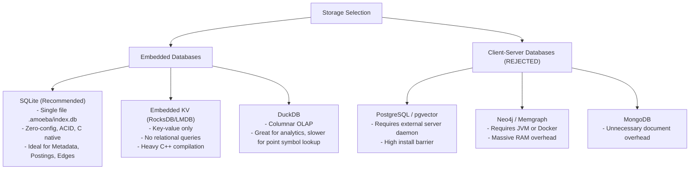
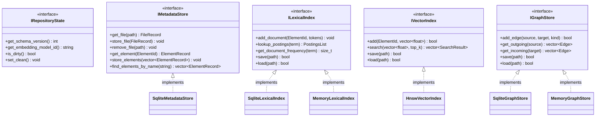
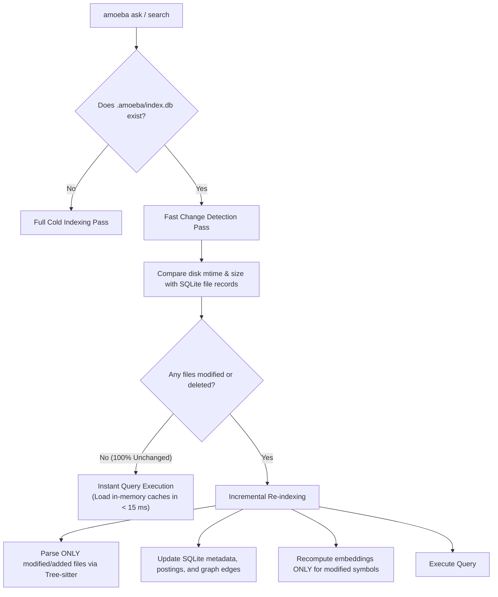

# Amoeba — Phase 10: Storage & Offline Architecture Research

**Date**: November 2026  
**Auditor**: Senior Software Architect & Systems Engineer  
**Status**: Complete  
**Scope**: Deep research into metadata persistence, vector indexing, graph storage, embedded databases, offline operation feasibility, and replaceable storage interfaces.

---

## 1. Current Storage & Persistence State in Amoeba

A thorough audit of the Amoeba codebase reveals that despite possessing persistence logic in isolated components, the application currently operates in an **entirely ephemeral, in-memory mode**:

```text
Current State:
  CLI Run ───► Scan Disk ───► Parse AST ───► Build RAM Postings ───► Embed RAM Vectors ───► Build RAM Graph ───► Query ───► Process Exit (All State Lost)
```

### 1.1 Subsystem Persistence Inventory

| Subsystem | Underlying Data Structure | Serialization Implemented? | Persisted in CLI? | Disk Format |
|---|---|---|---|---|
| **File Metadata** | `vector<FileInfo>` | **No** | **No** | None |
| **AST Symbol Table** | `vector<IndexedElement>` | **No** | **No** | None |
| **Lexical Index** | `unordered_map<string, vector<ElementId>>` | **No** | **No** | None |
| **Vector Index** | `hnswlib::HierarchicalNSW<float>` | **Yes** (`save()` / `load()`) | **No** | Custom `"AMOH"` binary + `.graph` |
| **Relationship Graph**| Dual adjacency `unordered_map` | **No** | **No** | None |
| **Repository State** | None | **No** | **No** | None |

### 1.2 The Current Vector Serialization Mechanism
In [`engine/src/semantic/hnsw_semantic_index.cpp:L243-L330`](file:///d:/amoeba/engine/src/semantic/hnsw_semantic_index.cpp#L243-L330):
* `HnswSemanticIndex::save(file_path)` writes:
  1. A 32-bit magic header `0x414D4F48` (`"AMOH"`).
  2. Version (1), index type (2 = HNSW), dimensions (384), vector count.
  3. Hyperparameters: $M$, $ef_{construction}$, $ef_{search}$, random seed.
  4. Flat array of `ElementId` and `float` embedding vectors.
  5. Companion binary file `${file_path}.graph` via `hnsw->saveIndex(graph_path)`.
* `HnswSemanticIndex::load(file_path)` validates the header and reads the companion graph.
* **Why it is not used**: `apps/cli/main.cpp` instantiates a brand new `HnswSemanticIndex` on each execution and never invokes `save()` or `load()`. No directory exists on disk (e.g. `.amoeba/`) to store the output.

---

## 2. Local-First Philosophy & Operational Requirements

### 2.1 The Core Requirement: Zero User Hassle
A developer using Amoeba must never be required to:
- Install, configure, or administer a PostgreSQL server with `pgvector`.
- Run a MongoDB daemon.
- Set up a Neo4j JVM instance or Memgraph Docker container.
- Manage network ports, firewalls, database passwords, or migration services.

The target user experience remains strictly:
```bash
amoeba index .
amoeba ask "How does authentication work?"
```
All persistence, state caching, and indexing must be **embedded, self-contained, and application-managed**.

### 2.2 Offline Operation Analysis

To qualify as genuinely offline-capable, every runtime dependency must function without an active internet connection after initial installation:

| Subsystem | Offline Capability | Current Code Reality | External Network Dependency? |
|---|---|---|---|
| **Filesystem Scanner** | **100% Offline** | Native `std::filesystem` directory iterator. | None. |
| **Tree-sitter Parsing**| **100% Offline** | C runtime and compiled grammars linked statically. | None. |
| **Lexical Indexing** | **100% Offline** | Pure C++ BM25 inverted index. | None. |
| **Semantic Embedding** | **100% Offline** | In-memory hash projection + static lexicon. | None. |
| **Vector Search** | **100% Offline** | Header-only `hnswlib` in RAM. | None. |
| **Graph Traversal** | **100% Offline** | In-memory dual adjacency maps. | None. |
| **Context Packaging** | **100% Offline** | In-memory C++ string formatting. | None. |
| **LLM Reasoning** | **Offline with Local LLM** | Communicates with local Ollama (`localhost:11434`). | None (after `ollama pull`). |

**Conclusion on Offline Readiness**:  
Amoeba is **100% offline-capable today** when using local Ollama. No mandatory cloud APIs exist in the core pipeline. Cloud LLM providers (OpenAI, Anthropic, Gemini) should remain strictly optional extensions.

---

## 3. Technology Evaluation: Storage & Database Alternatives

### 3.1 Metadata & Graph Storage Candidates



#### Detailed Comparison Matrix

| Technology | Architectural Fit | Installation Friction | Memory Overhead | Persistence & Recovery | Recommendation |
|---|---|---|---|---|---|
| **SQLite 3** | **Optimal** | **Zero** (embedded C library) | $< 10\text{ MB}$ RAM | ACID, WAL mode, crash-safe single file | **Adopt as primary local storage** |
| **DuckDB** | Fair (OLAP focus) | Zero (embedded C++) | ~50 MB RAM | Single file, columnar | Defer (overkill for point lookups) |
| **RocksDB / LMDB** | Fair (Key-Value) | Zero (embedded) | ~30 MB RAM | Log-structured merge tree | Reject (lacks structured queries) |
| **PostgreSQL + pgvector** | Poor (Server) | High (Server daemon + setup) | 150–500 MB RAM | Full RDBMS | **Reject (violates local-first)** |
| **Neo4j / Memgraph** | Poor (Server) | Extreme (JVM / Docker) | 500 MB–2 GB RAM | Graph database daemon | **Reject (violates local-first)** |

#### Why SQLite is the Decisive Winner for Amoeba
1. **Zero External Processes**: Compiles directly into `amoeba_engine` as a single C file (`sqlite3.c`).
2. **Single-File Portability**: All repository state lives inside `.amoeba/index.db`. Deleting or moving this file resets or migrates the index cleanly.
3. **Transactional Safety (ACID)**: If indexing is interrupted via `Ctrl+C` or a power cut, SQLite's Write-Ahead Logging (WAL) prevents database corruption.
4. **Relational Versatility**: SQLite effortlessly models:
   - File metadata (`path`, `mtime`, `hash`, `size`).
   - Code elements (`element_id`, `file_id`, `name`, `kind`, `start_line`, `end_line`, `detail`).
   - Inverted index postings (`term`, `element_id`, `term_freq`, `field_weight`).
   - Graph relationships (`source_id`, `target_id`, `kind`).

---

### 3.2 Vector Storage & ANN Index Candidates

| Technology | Architecture | Integration Effort | Memory / Performance | Persistence | Recommendation |
|---|---|---|---|---|---|
| **`hnswlib`** | Header-only C++ | **Zero** (already integrated) | In-memory graph; fastest queries ($< 1\text{ ms}$) | Native binary file export | **Retain as primary vector engine** |
| **`sqlite-vec`** | SQLite C extension | Low (C extension for SQLite) | In-database SIMD vector search | Automatically persisted in `.db` | **Investigate for unified storage** |
| **FAISS** | C++ library | High (BLAS/OpenMP dependencies) | Industrial scale ($10\text{M}+$ vectors) | Binary index format | Reject (unnecessary complexity) |
| **LanceDB** | Embedded / Arrow | Medium (C++ bindings maturing) | Fast on-disk IVF-PQ | Columnar Arrow format | Future consideration for massive codebases |
| **Qdrant (Server)**| Rust server daemon | High (Server daemon / HTTP) | High (External service) | Snapshot / Raft | Reject (violates local-first) |

#### Recommendation on Vector Storage:
* **Near Term (Phase 11)**: Keep `hnswlib`. Connect its existing `save()` and `load()` routines to the `.amoeba/` cache directory.
* **Medium Term (Phase 12+)**: Benchmark `sqlite-vec`. If `sqlite-vec` achieves acceptable latency ($< 10\text{ ms}$ for $k=50$), it eliminates the separate companion vector file, consolidating all metadata, text, graph, and vectors into a single `.amoeba/index.db` file!

---

### 3.3 Graph Subsystem: Custom In-Memory vs Graph Databases

A critical distinction must be maintained between:
1. **Graph Extraction**: Tree-sitter AST traversal identifying `Calls`, `Inherits`, `Imports`.
2. **Graph Data Structures**: In-memory adjacency lists vs matrix representations.
3. **Graph Persistence**: Saving edges to disk.
4. **Graph Algorithms**: BFS, DFS, Dijkstra, PageRank.
5. **Graph Visualization**: Exporting DOT/Mermaid diagrams.

#### Evaluation of Graph Alternatives

* **Why Neo4j / Memgraph are Rejected**:
  Running a standalone graph database server for a 5,000-symbol codebase is an anti-pattern. Cypher queries over TCP sockets incur $5\text{ ms} - 20\text{ ms}$ overhead per query. Amoeba's custom C++ graph resolves edges in **$< 1\ \mu\text{s}$** directly in RAM.
* **Why Boost Graph Library (BGL) is NOT Recommended**:
  BGL provides robust graph algorithms, but suffers from extreme template metaprogramming bloat, cryptic compiler diagnostics, significant compilation slowdowns, and zero persistence support.
* **Why Graphify / NetworkX are Inapplicable**:
  They are Python libraries; using them would force a Python runtime dependency into native C++.
* **Recommended Direction**:
  **Retain the Custom C++ In-Memory Adjacency Graph + Persist to SQLite**.
  - In RAM: `std::unordered_map<ElementId, vector<Relationship>>` provides maximum traversal speed during search.
  - On Disk: SQLite `edges` table (`source_id`, `target_id`, `kind`) provides durable, incremental persistence.

---

## 4. Proposed Clean Replaceable Storage Interfaces

To prevent hard-coupling the core retrieval engine to any specific database (such as SQLite or hnswlib), we propose small, cohesive interfaces following the Interface Segregation Principle (ISP) and Single Responsibility Principle (SRP).



### 4.1 Interface Definitions (C++20)

```cpp
// 1. Repository State & Migration Interface
class IRepositoryState {
public:
    virtual ~IRepositoryState() = default;
    [[nodiscard]] virtual uint32_t schema_version() const noexcept = 0;
    [[nodiscard]] virtual std::string embedding_model_id() const = 0;
    [[nodiscard]] virtual bool is_index_valid(const std::filesystem::path& repo_root) const = 0;
    virtual void record_completed_index(const std::filesystem::path& repo_root,
                                        std::string_view model_id) = 0;
};

// 2. Metadata Store Interface (Files & Symbols)
struct FileRecord {
    uint32_t file_id{0};
    std::string relative_path;
    uint64_t last_modified_time{0};
    uint64_t file_size{0};
    std::string sha256_hash;
};

class IMetadataStore {
public:
    virtual ~IMetadataStore() = default;
    [[nodiscard]] virtual std::optional<FileRecord> get_file(std::string_view relative_path) const = 0;
    virtual void upsert_file(const FileRecord& file) = 0;
    virtual void remove_file(uint32_t file_id) = 0;
    [[nodiscard]] virtual std::vector<FileRecord> all_files() const = 0;
};

// 3. Graph Store Interface (Persisted Relationships)
class IGraphStore {
public:
    virtual ~IGraphStore() = default;
    virtual bool add_edge(uint32_t source_id, uint32_t target_id, uint16_t kind) = 0;
    virtual bool remove_edges_for_element(uint32_t element_id) = 0;
    [[nodiscard]] virtual std::vector<Relationship> get_outgoing(uint32_t source_id) const = 0;
    [[nodiscard]] virtual std::vector<Relationship> get_incoming(uint32_t target_id) const = 0;
    virtual void flush() = 0;
};
```

---

## 5. Incremental Indexing & Invalidation Strategy

A major design flaw in Amoeba today is the absence of an incremental update path. To achieve instant search, the engine must distinguish between **unchanged**, **modified**, **added**, and **deleted** files:



### Invalidation Triggers
The entire index cache MUST be invalidated and rebuilt if:
1. **Engine Schema Version Changes**: Updated AST parser or new `ElementKind` enums.
2. **Embedding Model Changes**: User switches from `heuristic-hash` to `bge-code` or `qwen2.5-coder`.
3. **Repository Root Moves**: Absolute paths change (hence relative paths MUST be stored).

---

## 6. Recommendations for Next Phases

1. **Phase 11 (Immediate)**:
   - Introduce `.amoeba/` local directory.
   - Embed `sqlite3.c` into CMake build.
   - Implement `SqliteMetadataStore` to persist file timestamps and symbol tables.
   - Connect `HnswSemanticIndex::save()` and `load()` to `.amoeba/vectors.bin`.
   - Implement mtime-based incremental change detection.
2. **Phase 12 (Graph & Lexical Persistence)**:
   - Persist InvertedIndex postings to SQLite tables or mapped binary format.
   - Persist RelationshipGraph edges to SQLite.
   - Achieve $< 50\text{ ms}$ cold start on warm repositories.
3. **Phase 13 (Vector Evolution)**:
   - Evaluate `sqlite-vec` to test single-file `.db` vector storage.
   - Integrate optional ONNX Runtime / Ollama embedding provider for true semantic vectors.

